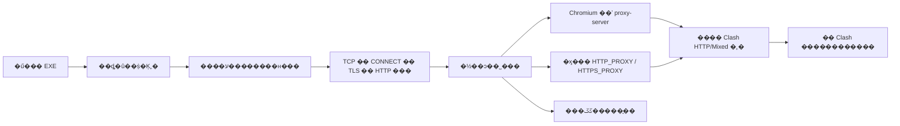

# Codex Windows Proxy Launcher

Ϊ Windows ΢���̵�� `OpenAI.Codex` �ṩӦ�ü�����������ڣ�Clash �ں�̨�������� HTTP/Mixed �˿�ʱ������ͨ�������������� Windows ϵͳ������ TUN��

**��ǰΪ `1.0.0-rc.1` ��ѡ�档�°�ͻ��˵�����������������������δ��ɡ�** ���ȿ� [��֤��¼](VALIDATION.md)����Ҫ�ѡ��ļ��ѹ��������������ֳɹ�������Ϊ�����й����Ѿ�ͨ�����ԡ���

English: An open-source, per-process proxy launcher for the Microsoft Store `OpenAI.Codex` desktop client on Windows. Includes editable scripts and a portable GUI EXE built from the same PowerShell core. You provide your own local HTTP/Mixed proxy port. Client cold-start and feature acceptance remain explicitly pending in this release candidate.

- [���غ�ѡ���а�](https://github.com/LiKa233/codex-windows-proxy-launcher/releases)
- [���� Codex skill](https://github.com/LiKa233/codex-windows-proxy-skill)
- [MIT ����֤](LICENSE)

## ���л��������ð汾

| ��Ŀ | �װ淶Χ |
|---|---|
| ����ϵͳ | Windows x64����ǰ����/���ƽ̨Ϊ Windows 11���汾 `10.0.26100` |
| Windows ���Ҫ�� | �����ͻ����嵥Ϊ `10.0.19041.0`��������ż������� Windows 10 �����ʵ�� |
| �ͻ��� | ��ǰ�û���ע���΢���̵�� `OpenAI.Codex_2p2nqsd0c76g0` |
| ������ | Windows �Դ� Windows PowerShell 5.1 |
| EXE ����ʱ | .NET Framework 4.8 ����ߵļ��� 4.x ����ʱ |
| �������� | ������֤�� HTTP/Mixed �����˿ڣ�Ĭ�ϵ�ַ `127.0.0.1`���˿����û���д |
| �������װ淶Χ | macOS��Linux��WSL �ڿͻ��ˡ�������װ���塢ARM64 ԭ�����С�SOCKS-only/����֤�Ĵ��� |

����Ҫ������װ Python��Node.js��PowerShell 7 ��ȫ�� Codex CLI�������������� Codex �ͻ��ˡ�Clash�������ڵ㡢�˺Ż� API ƾ�ݡ�

### �ͻ��˰汾���

| ��� | ���ι۲�ֵ | ״̬ |
|---|---|---|
| ��ע�� MSIX �� | `26.1013.4894.0` | ע����Ϣ���嵥�Ϳ�ִ��·���Ѽ�飻���������� |
| �ð���Ӧ�� package.json | `26.1013.40934` | ֻ����ȡ��Ӧ�ð汾�������� MSIX �汾���� |
| �ð��� CLI | `0.163.0-alpha.10.2` | �汾�����Ѷ�ȡ����������ǰ���к�̨��ʹ���� |
| ��ǰ�������еľ� MSIX | `26.1007.9446.0` | �۲쵽ԭ�������Ĵ��������ͺ�̨�����������ӣ����°���֤ |
| ��ǰ�ɺ�̨ CLI | `0.162.0-alpha.17.2` | ��ǰ����·����Ӧ�İ汾 |

�˱���¼���� 2026-10-22 ���ض��������°汾�����ע����Ϣ��̬��λ����**�Զ��ҵ���·���������°汾����֤����**����ϸ״̬�����鹦�ܼ� [VALIDATION.md](VALIDATION.md)��

## ����ʹ��

1. ��װ����¼΢���̵��ͻ��ˣ����Լ��� Clash/���ݴ��������ں�̨���У�ȷ���� **HTTP �� Mixed** �˿ڡ�ϵͳ������ TUN ���Ա��ֹرա�
2. �� Releases ���� EXE������������ ZIP ����ѹ����ǰ�û���д��Ŀ¼���ȶԷ���ҳ�� `SHA256SUMS.txt`��
3. �������ڽ��е�����**������ȫ�˳�**�ɵ�����ͻ��ˡ�����������������н��̡�
4. ˫�� `CodexProxyLauncher.exe`����һ�λᵯ�����ô��ڣ���д�Լ��Ķ˿ڣ�ȡ����������û��Ԥ��� 7897/7890��Ҳ����ɨ��˿ڡ�
5. ȷ�Ͽͻ��������ڡ��˺š�ʵ�ʶԻ�����Ҫ�Ĺ����ܹ����������Ѿ�����Ҳ���������Щ���ա�

�ű��棺˫�� ZIP �е� `Codex Proxy Launcher.cmd`������ EXE ʹ����ͬ���ģ��ű���� `.cmd`��`.ps1`��`.psm1` �豣����ͬһĿ¼��

EXE ���Ե������ã����Ὣ��Ƕ�Ľű��ͷŵ���ǰ�û� `%LOCALAPPDATA%\CodexProxyLauncher\runtime\<payload-hash>` ��У�����ݡ�**��������һ�׶���ʵ��**��Ҳ�����������û��� Codex ��������ʱ��

## ����������

�����ļ�Ϊ����Ե� `launcher.config.json`���״���д���Զ����ɣ�

```json
{
  "schemaVersion": 1,
  "proxyHost": "127.0.0.1",
  "proxyPort": null
}
```

������ģ�壻`null` ���뻻���û��Լ��� **1�C65535 ����**�������Ч���á������ֹ�����ģ�壬�״����������������Ч�ļ��������ַ���� `127.0.0.1`��`localhost` �� `::1`��������ַ���뱾������һ�¡�

- �޸Ķ˿ڣ�˫�� `Configure Proxy.cmd`�������� `CodexProxyLauncher.exe --configure`����ֱ�ӱ༭ JSON��
- �鿴��飺˫�� `Check Proxy.cmd`�������� `CodexProxyLauncher.exe --check` �鿴ֻ�����档
- ����ֵ�ؼ�飺�� Windows PowerShell 5.1 ִ������������ᵯ����д��־�������û������ͻ��ˡ�

```powershell
powershell.exe -NoProfile -ExecutionPolicy Bypass -File .\Launcher.ps1 -CheckOnly
```

�ű�֧�� `-ConfigPath <����·��>` ѡ�������ļ���EXE Ĭ��ʹ�������Ե����ã�·�������ġ��ո������ʱ���ᱻƴ�ӳɿ�ִ�� PowerShell ���롣EXE �ļ����ڵ�һ�������ͷ��Դ��Ľű����棻ֻ����鱾����д���û���־��

| �˳��� | ���� |
|---|---|
| `0` | �����ѱ��桢�����Ѵ��������ݴ���ֻ�����İ����֣�CONNECT/TLS ��ͨ�����谴����ģʽ���� |
| `2` | �û�ȡ���״����� |
| `20` | ���á������֡����н��̡���������ʧ�� |
| `21` | ����Ԥ��δͨ�����û�ѡ�񲻼��� |

�������ò���Ӱ���Ѿ����еĿͻ��ˡ���Ŀ¼����д�����Ƶ��Լ���д��Ŀ¼�����������ᾲĬ��һ������λ�á�

## ����ԭ��



### �����������

| �� | ���ü��߽� |
|---|---|
| Electron/Chromium �� HTTP��HTTPS��WebSocket | `--proxy-server=http://127.0.0.1:<�û��˿�>` ֱ��ָ������������ϵͳ����ѡ�� |
| �ӽ�����֧�ֻ�������������� | �½��̵� `HTTP_PROXY`��`HTTPS_PROXY` ָ��ͬһ HTTP �������Ƿ���Чȡ���ھ���� |
| �����ػ� | ������ `--proxy-bypass-list=<-loopback>`������ Chromium ��ʽ����ֱ�����ӽ��� `NO_PROXY=localhost,127.0.0.1,::1` |
| �������̼�ȫ������ | �����û�/����������ϵͳ������Clash ���á�TUN������������� `config.toml` |

`HTTPS_PROXY` ��ֵΪ `http://...` ������ģ�����ʾͨ�� HTTP CONNECT �������� HTTPS Ŀ�꣬�������ڹر�Ŀ�� TLS��ֻ���½��̵Ļ������Ƴ����ܳ�ͻ�� `ALL_PROXY`������ `CODEX_HOME`��`SSL_CERT_FILE` ���������á�Windows ���������������ִ�Сд���ظ�����Сд����û�ж������á�

**�����ƹ�����������Ŀ�꣬���Ǵ�����������ַ��** ���� `chatgpt.com` ����ͨ��λ�� `127.0.0.1` �� Clash�����ʱ���������ֱ�����ӡ�`<-loopback>` ����ʵ������ȡ����ʽ�����ƹ����������ӱ���ֱ������

��������������й����ý������̣������������������ǿ��ʵ�ִ�����Ҳ���ܱ�֤�����ⲿ����UDP/WebRTC �����Ķ���������ѭ��Щ���á�Clash �����ķ�������ͽڵ�����Ҳ��Ȼ����ʵ�ʳ��ڡ���ˡ�ϵͳ�����ر�ʱ���й��ܿ��á���������ʵ�⡣

### �汾�����뵥ʵ��

�������ӵ�ǰ�û�ע��� `Get-AppxPackage` ��Ϣ��ȡ��װĿ¼���Ӱ��嵥�� `App` ��Ŀ��ȡ��ִ���ļ��������·��û���ӳ���Ŀ¼�����ᰴ WindowsApps Ŀ¼�޸�ʱ����ѡһ������δע��ľɰ���

������н���ʱƥ�� `OpenAI.Codex_*\app\ChatGPT.exe`�������ɰ��汾������������ɰ������У������������������þ�ʵ�������´�������δ�������¡�������Դ�޷�ʶ��ʱ��ֹͣ��˵��ԭ�򣬲����������ɹ���

## ������������

| ���� | ��֤��ʲô | ����֤��ʲô |
|---|---|---|
| TCP | �����˿ڽ������� | �˿����� Clash��֧�� HTTP ���� |
| HTTP CONNECT | Ŀ����������õ���Ч `200` | TLS���˺Ż�ģ�Ϳ��� |
| TLS | �� `chatgpt.com` �������� TLS ����ͨ�� | �ѵ�¼�����к�˶��ɴ� |
| HTTP | �յ�״̬�룻���� 401��403 �Ϳ�ʶ�����ҳ��֤ | ͨ����ҳ��¼�������Ի� |
| �ͻ����빦������ | ��¼�ض��汾�µ���ʵ��Ϊ | �����汾�����������Զ����� |

`-CheckOnly` �� `Success` ��ȷֻ��ʾ���ֿͻ����� CONNECT/TLS ͨ������Ч TLS ��� HTTP 403/��ҳ��֤�Լ�¼Ϊҵ��δ��֤������Ϊ����̽�⡰���̡��ر�֤��У�顣

## ��������

**Clash �ں�̨������ϵͳ����������** ���Ը��ͻ�����ʽָ����������������Ҫϵͳ�������أ��������ܵĸ���״̬����֤��Ϊ׼�����������������л�ȫ�ֿ��أ�Ҳ�����δ֪�� TUN ״̬д���ѹرա�

**�˿�ͨ�ˣ������ʧ�ܣ�** �������� SOCKS-only �˿ڡ�����Ҫ����֤��CONNECT ���ܡ�TLS ����ʧ�ܻ����糬ʱ���鿴 JSON �е�ʧ�ܽ׶Σ���ֻ���˿ڡ�

**`LocalTlsCredentialError` / `SEC_E_NO_CREDENTIALS`��** ������ı��� Schannel �����޷�ȡ��ƾ֤������ͨ Windows PowerShell 5.1 ���ظ�ֻ����飬���ж����硣����ִ������Ĵ˴�����ֱ�ӹ����ڴ����ڵ㡣

**��鷵�� 403 ����ҳ��֤��** ����ܷ������ѽ����� TLS ����֮�����Ȳ�֤���������ˣ�Ҳ��֤���˺��������ÿͻ��˼������գ����Զ�������֤����˻�ƾ�ݡ�

**�Ѽ�⵽�ͻ������У�** ���������������ȫ�˳��������������� `taskkill`������ɾ���Ự�����豸��

**�̵���º���ô�죿** ��һ�δ�ע����Ϣ��λ��·�������������¼�¼�汾/���ܽ�����ҵ���·�����Զ���������֤��Χ��

**�ű�����֯������ֹ��** �����е� `ExecutionPolicy Bypass` ֻ�����ڸ������̣������ܸ���ǿ����֯���ԡ�������������Ļ���ִ�в��ԡ�֤�����λ�ȫ��Ʒ���á�

**EXE ��ǩ����** ��ǰ������δ����/���ô���ǩ��֤�飻�ṩԴ�롢���������� SHA-256����Ҫ�ѹ�ϣУ������Ϊ����������ǩ����

**��־��ж�أ�** ������־�� `%LOCALAPPDATA%\CodexProxyLauncher\logs`����ת����Լ 1 MiB��ֻ��������ܰ�������·��������ǰ�����ġ���Я��ɾ���Լ�������ļ����ɣ�����/��־���ֶ�ɾ����skill ��װ��ʹ����ж�ؽű���Ĭ�ϱ������á����漰 Codex �˺š��ͻ��˰��� `.codex` ���ݡ�

## ��������������

```powershell
powershell.exe -NoProfile -ExecutionPolicy Bypass -File .\tests\Run-Tests.ps1
powershell.exe -NoProfile -ExecutionPolicy Bypass -File .\build.ps1
```

����ʹ�� Windows �Դ� .NET Framework C# ����������� EXE������ ZIP��SHA-256 �嵥�� `dist`��C# ��ͼ����ں���Դ�ͷŲ㣻��������/�����Ϊ�ڿ����ĵ� PowerShell �����С�`--verify-payload` ���� GUI�������硢������д�롢�޿ͻ��������ķ��������Լ�顣

Windows CI ִ����ͬ���Զ������빹����CI ��û���ѵ�¼��Ŀ��ͻ��ˣ����ܴ������湦�����ա��������Խ�����ʱĿ¼��װ��ʹ���������������ͨ PowerShell �ӽ��̣���������ʵ�ͻ��ˡ�

���� skill �ڴ�ͬһ�汾�Ľű����ա�ά�����޸ĺ��ĺ�Ӧ���� `tools/Export-SkillPayload.ps1 -SkillRepository <skill�ֿ�·��>`������ SHA-256���ٷֱ���֤���ֿ⡣����ʱ�����ز��̶��汾��Զ�˽ű���

## ԭ�������ժҪ

�������������û���/·��Ӳ���롢�Ѵ��˿ڵ� HTTP ���������ʧ���Է��سɹ������ģʽд��־��������©��ɽ��̡�������ͱ����ƹ������������֤��������ѽ��̴����������ɹ���

δ����ȱ�ٳ��֤�ݵľ����жϣ����硰�˻�ֻ������ʱ��ѯһ���Ҿ������ԡ���ij�������С��Ȼ��������������ǰδ�޸� `respect_system_proxy`�������DZ����߰�װʱǿ��д���ǰ��������

���ݣ�[Electron �����в���](https://www.electronjs.org/docs/latest/api/command-line-switches)��[Chromium �����뱾���ƹ�](https://chromium.googlesource.com/chromium/src/+/HEAD/net/docs/proxy.md)��[OpenAI Windows �ͻ����ĵ�](https://learn.chatgpt.com/docs/windows/windows-app)���ĵ�˵�����ƣ����ؼ��͹����������м�¼��
