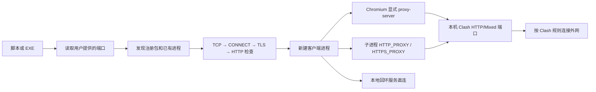

# Codex Windows Proxy Launcher

为 Windows 微软商店版 `OpenAI.Codex` 提供应用级代理启动入口：Clash 在后台监听本机 HTTP/Mixed 端口时，无需通过本启动器开启 Windows 系统代理或 TUN。

**当前为 `1.0.0-rc.1` 候选版。新版客户端的冷启动和完整功能验收尚未完成。** 请先看 [验证记录](VALIDATION.md)，不要把“文件已构建”“代理握手成功”理解为“所有功能已经通过测试”。

English: An open-source, per-process proxy launcher for the Microsoft Store `OpenAI.Codex` desktop client on Windows. Includes editable scripts and a portable GUI EXE built from the same PowerShell core. You provide your own local HTTP/Mixed proxy port. Client cold-start and feature acceptance remain explicitly pending in this release candidate.

- [下载候选发行包](https://github.com/LiKa233/codex-windows-proxy-launcher/releases)
- [配套 Codex skill](https://github.com/LiKa233/codex-windows-proxy-skill)
- [MIT 许可证](LICENSE)

## 运行环境与适用版本

| 项目 | 首版范围 |
|---|---|
| 操作系统 | Windows x64；当前开发/检查平台为 Windows 11，版本 `10.0.26100` |
| Windows 最低要求 | 被检查客户端清单为 `10.0.19041.0`；满足此门槛不代表 Windows 10 已完成实测 |
| 客户端 | 当前用户已注册的微软商店包 `OpenAI.Codex_2p2nqsd0c76g0` |
| 解释器 | Windows 自带 Windows PowerShell 5.1 |
| EXE 运行时 | .NET Framework 4.8 或更高的兼容 4.x 运行时 |
| 本机代理 | 无需认证的 HTTP/Mixed 监听端口；默认地址 `127.0.0.1`，端口由用户填写 |
| 不属于首版范围 | macOS、Linux、WSL 内客户端、其他安装包族、ARM64 原生发行、SOCKS-only/需认证的代理 |

不需要单独安装 Python、Node.js、PowerShell 7 或全局 Codex CLI。启动器不包含 Codex 客户端、Clash、代理节点、账号或 API 凭据。

### 客户端版本标记

| 组件 | 本次观察值 | 状态 |
|---|---|---|
| 已注册 MSIX 包 | `26.1013.4894.0` | 注册信息、清单和可执行路径已检查；冷启动待验 |
| 该包内应用 package.json | `26.1013.40934` | 只读提取的应用版本，不能与 MSIX 版本混用 |
| 该包内 CLI | `0.163.0-alpha.10.2` | 版本命令已读取；不代表当前运行后台已使用它 |
| 当前仍在运行的旧 MSIX | `26.1007.9446.0` | 观察到原启动器的代理参数和后台到代理的连接；非新版验证 |
| 当前旧后台 CLI | `0.162.0-alpha.17.2` | 当前运行路径对应的版本 |

此表记录的是 2026-10-22 的特定环境。新版本会根据注册信息动态定位，但**自动找到新路径不等于新版本已验证兼容**。详细状态及待验功能见 [VALIDATION.md](VALIDATION.md)。

## 快速使用

1. 安装并登录微软商店版客户端；让自己的 Clash/兼容代理软件在后台运行，确认其 **HTTP 或 Mixed** 端口。系统代理和 TUN 可以保持关闭。
2. 从 Releases 下载 EXE，或下载完整 ZIP 并解压到当前用户可写的目录。比对发行页的 `SHA256SUMS.txt`。
3. 保存正在进行的任务，**自行完全退出**旧的桌面客户端。启动器不会结束现有进程。
4. 双击 `CodexProxyLauncher.exe`。第一次会弹出配置窗口，填写自己的端口；取消则不启动。没有预设的 7897/7890，也不会扫描端口。
5. 确认客户端主窗口、账号、实际对话和需要的工具能工作。界面已经出现也不能替代这些验收。

脚本版：双击 ZIP 中的 `Codex Proxy Launcher.cmd`。它与 EXE 使用相同核心；脚本版的 `.cmd`、`.ps1`、`.psm1` 需保留在同一目录。

EXE 可以单独放置；它会将内嵌的脚本释放到当前用户 `%LOCALAPPDATA%\CodexProxyLauncher\runtime\<payload-hash>` 并校验内容。**它不是另一套独立实现**，也不调用其他用户的 Codex 缓存运行时。

## 配置与命令

配置文件为入口旁的 `launcher.config.json`。首次填写后自动生成：

```json
{
  "schemaVersion": 1,
  "proxyHost": "127.0.0.1",
  "proxyPort": null
}
```

上面是模板；`null` 必须换成用户自己的 **1–65535 整数**后才是有效配置。无需手工创建模板，首次启动界面会生成有效文件。本版地址限于 `127.0.0.1`、`localhost` 或 `::1`；监听地址需与本机代理一致。

- 修改端口：双击 `Configure Proxy.cmd`，或运行 `CodexProxyLauncher.exe --configure`，或直接编辑 JSON。
- 查看检查：双击 `Check Proxy.cmd`，或运行 `CodexProxyLauncher.exe --check` 查看只读报告。
- 无人值守检查：用 Windows PowerShell 5.1 执行下列命令，不会弹窗、写日志、改配置或启动客户端。

```powershell
powershell.exe -NoProfile -ExecutionPolicy Bypass -File .\Launcher.ps1 -CheckOnly
```

脚本支持 `-ConfigPath <完整路径>` 选择配置文件。EXE 默认使用自身旁的配置，路径含中文、空格或单引号时不会被拼接成可执行 PowerShell 代码。EXE 的检查入口第一次仍需释放自带的脚本缓存；只读检查本身不写配置或日志。

| 退出码 | 含义 |
|---|---|
| `0` | 配置已保存、进程已创建并短暂存活，或只读检查的包发现＋CONNECT/TLS 已通过；需按运行模式解释 |
| `2` | 用户取消首次配置 |
| `20` | 配置、包发现、已有进程、启动或检查失败 |
| `21` | 启动预检未通过，用户选择不继续 |

更改配置不会影响已经运行的客户端。若目录不可写，请移到自己可写的目录，启动器不会静默换一个配置位置。

## 工作原理



### 两层代理设置

| 层 | 设置及边界 |
|---|---|
| Electron/Chromium 的 HTTP、HTTPS、WebSocket | `--proxy-server=http://127.0.0.1:<用户端口>` 直接指定代理，覆盖系统代理选择 |
| 子进程中支持环境变量的网络库 | 新进程的 `HTTP_PROXY`、`HTTPS_PROXY` 指向同一 HTTP 代理；是否生效取决于具体库 |
| 本机回环 | 不添加 `--proxy-bypass-list=<-loopback>`；保留 Chromium 隐式本地直连。子进程 `NO_PROXY=localhost,127.0.0.1,::1` |
| 其他进程及全局设置 | 不改用户/机器环境、系统代理、Clash 配置、TUN、自启动任务或 `config.toml` |

`HTTPS_PROXY` 的值为 `http://...` 是有意的：它表示通过 HTTP CONNECT 隧道访问 HTTPS 目标，并不等于关闭目标 TLS。只在新进程的环境中移除可能冲突的 `ALL_PROXY`；保留 `CODEX_HOME`、`SSL_CERT_FILE` 等现有设置。Windows 环境变量名不区分大小写，重复设置小写别名没有额外作用。

**本地绕过看的是请求目标，不是代理服务器地址。** 访问 `chatgpt.com` 仍能通过位于 `127.0.0.1` 的 Clash；访问本机服务则直接连接。`<-loopback>` 的真实含义是取消隐式本地绕过，不是添加本地直连规则。

启动器仅负责把有关设置交给进程；它不能替所有网络库强制实现代理，也不能保证任意外部程序、UDP/WebRTC 或插件的独立服务遵循这些设置。Clash 自身的分流规则和节点质量也仍然决定实际出口。因此“系统代理关闭时所有功能可用”必须逐项实测。

### 版本更新与单实例

启动器从当前用户注册的 `Get-AppxPackage` 信息读取安装目录，从包清单的 `App` 条目读取可执行文件，并检查路径没有逃出包目录。不会按 WindowsApps 目录修改时间挑选一个可能未注册的旧包。

检查已有进程时匹配 `OpenAI.Codex_*\app\ChatGPT.exe`，包括旧包版本。否则升级后旧版仍运行，可能让新启动请求复用旧实例，导致代理环境未真正更新。进程来源无法识别时会停止并说明原因，不声称启动成功。

## 检查结果如何理解

| 检查层 | 能证明什么 | 不能证明什么 |
|---|---|---|
| TCP | 本机端口接受连接 | 端口属于 Clash、支持 HTTP 代理 |
| HTTP CONNECT | 目标隧道请求得到有效 `200` | TLS、账号或模型可用 |
| TLS | 对 `chatgpt.com` 的受信任 TLS 握手通过 | 已登录、所有后端都可达 |
| HTTP | 收到状态码；区分 401、403 和可识别的网页验证 | 通过网页登录或完整对话 |
| 客户端与功能验收 | 记录特定版本下的真实行为 | 其他版本、其他功能自动兼容 |

`-CheckOnly` 的 `Success` 明确只表示发现客户端且 CONNECT/TLS 通过。有效 TLS 后的 HTTP 403/网页验证仍记录为业务未验证。不会为了让探测“变绿”关闭证书校验。

## 常见问题

**Clash 在后台，不开系统代理可以吗？** 可以给客户端显式指定本机代理，不需要系统代理开关；但各功能的覆盖状态以验证表为准。启动器不会替你切换全局开关，也不会把未知的 TUN 状态写成已关闭。

**端口通了，但检查失败？** 可能用了 SOCKS-only 端口、代理要求认证、CONNECT 被拒、TLS 信任失败或网络超时。查看 JSON 中的失败阶段，别只看端口。

**`LocalTlsCredentialError` / `SEC_E_NO_CREDENTIALS`？** 检测器的本机 Schannel 环境无法取得凭证。在普通 Windows PowerShell 5.1 中重复只读检查，再判断网络。受限执行器里的此错误不能直接归因于代理节点。

**检查返回 403 或网页验证？** 这可能发生在已建立的 TLS 连接之后；它既不证明代理断了，也不证明账号正常。用客户端继续验收，不自动处理验证码或账户凭据。

**已检测到客户端运行？** 保存任务后自行完全退出，再启动。不会 `taskkill`，不会删除会话或解绑设备。

**商店更新后怎么办？** 下一次从注册信息定位新路径；重启并重新记录版本/功能结果。找到新路径不自动扩大已验证范围。

**脚本受组织策略阻止？** 参数中的 `ExecutionPolicy Bypass` 只作用于辅助进程，并不能覆盖强制组织策略。启动器不会更改机器执行策略、证书信任或安全产品设置。

**EXE 有签名吗？** 当前发行物未购买/配置代码签名证书；提供源码、构建方法和 SHA-256。不要把哈希校验理解为发行者身份签名。

**日志和卸载？** 启动日志在 `%LOCALAPPDATA%\CodexProxyLauncher\logs`，轮转上限约 1 MiB。只读报告可能包含本机路径，分享前先审阅。便携版删除自己保存的文件即可；缓存/日志可手动删除。skill 安装版使用其卸载脚本，默认保留配置。不涉及 Codex 账号、客户端包或 `.codex` 数据。

## 构建、测试与维护

```powershell
powershell.exe -NoProfile -ExecutionPolicy Bypass -File .\tests\Run-Tests.ps1
powershell.exe -NoProfile -ExecutionPolicy Bypass -File .\build.ps1
```

构建使用 Windows 自带 .NET Framework C# 编译器，输出 EXE、完整 ZIP、SHA-256 清单到 `dist`。C# 是图形入口和资源释放层；所有启动/检测行为在可审阅的 PowerShell 核心中。`--verify-payload` 是无 GUI、无网络、无配置写入、无客户端启动的发行完整性检查。

Windows CI 执行相同的自动测试与构建；CI 上没有已登录的目标客户端，不能代替桌面功能验收。开发测试仅在临时目录安装、使用虚拟监听器和普通 PowerShell 子进程，不结束真实客户端。

配套 skill 内带同一版本的脚本快照。维护者修改核心后，应运行 `tools/Export-SkillPayload.ps1 -SkillRepository <skill仓库路径>`，更新 SHA-256，再分别验证两仓库。运行时不下载不固定版本的远端脚本。

仓库的 `.gitattributes` 禁用自动换行转换，保留哈希所依赖的原始 UTF-8 字节。维护快照时也须保留实际字节，不能在发布过程中改变编码或行尾后继续沿用旧哈希。

## 原方案审计摘要

已修正：本机用户名/路径硬编码、把存活端口当 HTTP 代理、检查失败仍返回成功、检查模式写日志、升级后漏检旧进程、错误解释本地绕过、无条件清除证书变量及把进程创建当完整成功。

未沿用缺少充分证据的绝对判断，例如“账户只在启动时查询一次且绝不重试”或“某个请求大小必然导致重连”。当前未修改 `respect_system_proxy`；它不是本工具安装时强制写入的前置条件。

依据：[Electron 命令行参数](https://www.electronjs.org/docs/latest/api/command-line-switches)、[Chromium 代理与本地绕过](https://chromium.googlesource.com/chromium/src/+/HEAD/net/docs/proxy.md)、[OpenAI Windows 客户端文档](https://learn.chatgpt.com/docs/windows/windows-app)。文档说明机制；本地检查和功能验收另行记录。
